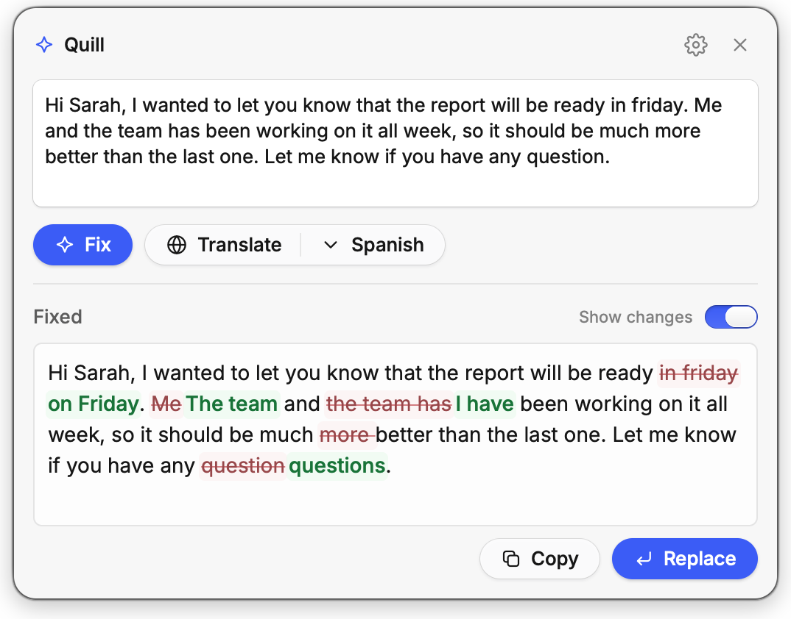
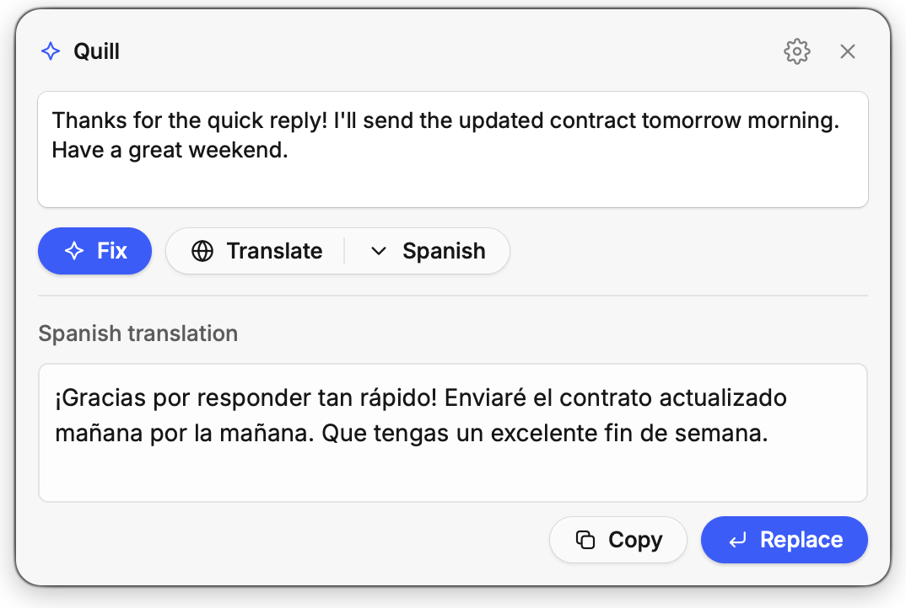

<div align="center">


# Fettle

**Fix grammar, rewrite and translate text in any Mac app with one shortcut.**

Select text, press <kbd>⌃</kbd><kbd>⌥</kbd><kbd>E</kbd>, and click **Fix**, **Translate** or **Rewrite**.<br>
A free, open-source AI writing assistant for macOS that can run entirely on your Mac, and a lightweight alternative to Grammarly.

[](https://github.com/iyazerski/fettle/releases/latest/download/Fettle.dmg)
[](#install)
[](LICENSE)
[](https://www.rust-lang.org)
[](https://buymeacoffee.com/iyazerski)

**Fix**<br>
<picture>
  <source media="(prefers-color-scheme: dark)" srcset="docs/screenshots/fix-dark.png">
  
</picture>

**Translate**<br>
<picture>
  <source media="(prefers-color-scheme: dark)" srcset="docs/screenshots/translate-dark.png">
  
</picture>

</div>

## Why Fettle

- **Runs on your Mac, for free.** With Apple Intelligence on macOS 26, Fettle uses Apple's on-device model. No account, no API key, and your text never leaves your Mac.
- **Works in every app.** Mail, Slack, Notes, your browser, your code editor. If you can select the text, Fettle can fix it.
- **See every change.** Fixes show up word by word, like track changes.
- **Any language.** Fix and Rewrite work in any language the model knows, and keep your text in the language you wrote it in.
- **Rewrite in one click.** Make text more formal, friendlier, shorter or clearer.
- **Translate into 40 languages.** Fettle keeps the tone, formatting, names, links and code. Star the languages you use most to keep them at the top.
- **Paste it back in one keystroke.** <kbd>⌘</kbd><kbd>↩</kbd> replaces your selection with the result. Your clipboard stays as it was.
- **Or use a bigger model.** Sign in with ChatGPT, or point Fettle at any OpenAI-compatible API, such as OpenAI, OpenRouter, or a local model in Ollama or LM Studio.
- **Native and tiny.** Written in Rust, a 10 MB download, about 12 MB of memory when idle, and no CPU use until you call it.
- **Private by design.** No account, no telemetry, no servers of ours. Your text stays on your Mac, or goes only to the model you pick.
- **Free and open source** under the MIT license.

## Install

For macOS 13 or later on Apple silicon (M1 and newer). The on-device model needs macOS 26 with Apple Intelligence turned on. Pick one:

- [**Download**](https://github.com/iyazerski/fettle/releases/latest/download/Fettle.dmg) and install the latest release.
- **Homebrew:** `brew install --cask iyazerski/tap/fettle`

### First launch

Fettle isn't notarized by Apple yet, so macOS blocks it the first time you open it. To allow it:

1. Open Fettle from Applications. macOS says it can't verify the app. Click **Done**.
2. Open **System Settings > Privacy & Security** and scroll down to **Security**.
3. Click **Open Anyway** next to the message about Fettle, and confirm.

## FAQ

<details>
<summary><b>Why the name?</b></summary>

To fettle is an old English word for to tidy up or put right, and "in fine fettle" means in good shape. That's what Fettle does to your text.

</details>
<details>
<summary><b>Is Fettle a Grammarly alternative?</b></summary>

Yes, for the core job: fixing grammar, spelling and phrasing in any app, with a clear view of what changed. It doesn't underline mistakes as you type. You select the text and press the shortcut when you want a check.

</details>
<details>
<summary><b>Which apps does it work in?</b></summary>

Any app where you can select text and copy it with <kbd>⌘</kbd><kbd>C</kbd>. **Replace** needs a text field you can type into.

</details>
<details>
<summary><b>Which languages does it support?</b></summary>

Fix and Rewrite work in any language the model knows, whatever language the app is in. Your text stays in the language you wrote it in. Translate goes into 40 languages. The app itself is in English, Spanish, French, German, Portuguese, Polish, Russian, Chinese, Japanese, Korean, Hindi and Arabic, and follows your Mac's language unless you pick one in Settings.

</details>
<details>
<summary><b>Which AI models can I use?</b></summary>

- **On this Mac:** Apple's on-device model, which comes with Apple Intelligence on macOS 26. It's free and private, but smaller, so it takes shorter texts and fewer languages.
- **ChatGPT plan:** the models your plan offers through Codex.
- **API:** any model that the API's `/v1/models` endpoint lists.

</details>
<details>
<summary><b>Why does Fettle say Apple Intelligence isn't ready?</b></summary>

Turn it on in **System Settings > Apple Intelligence & Siri**. Your Mac and Siri must use the same language, and Apple Intelligence must support it: English, French, German, Italian, Spanish, Portuguese, Japanese, Korean, Chinese, Danish, Dutch, Norwegian, Swedish, Turkish or Vietnamese. Right after you turn it on, macOS may need a while to download the model.

</details>
<details>
<summary><b>Does it cost anything?</b></summary>

Fettle and the on-device model are free. Other models are billed by your provider: they're part of your ChatGPT plan, or charged by your API provider.

</details>
<details>
<summary><b>Does it run on Intel Macs, Windows or Linux?</b></summary>

Not yet. Fettle is built for macOS on Apple silicon.

</details>
<details>
<summary><b>Is it safe to grant Accessibility?</b></summary>

Fettle uses it only to press <kbd>⌘</kbd><kbd>C</kbd> and <kbd>⌘</kbd><kbd>V</kbd> when you call it. The code is open, so you can check.

</details>

## Build from source

Fettle is a native Rust app built on the [Rune](https://github.com/anomalyco/rune) UI framework.

```sh
make install   # build Fettle.app and put it in /Applications
make test
```

Pre-commit hooks run with [prek](https://github.com/j178/prek): `prek install`.

## Privacy

- Fettle has no account and no analytics, and it has no server of its own.
- With **On this Mac**, your text never leaves your Mac.
- Otherwise, the text you fix or translate goes only to the model provider you chose: OpenAI when you sign in with ChatGPT, or the API URL you entered.
- Your ChatGPT sign-in and API key are kept in the macOS Keychain.
- Fettle restores your clipboard after it copies and pastes.

## License

[MIT](LICENSE) © Ihar Yazerski. Fettle includes open-source software under its own licenses: see [THIRD_PARTY_LICENSES.md](THIRD_PARTY_LICENSES.md). Issues and pull requests are welcome: see [CONTRIBUTING.md](CONTRIBUTING.md).

Fettle isn't affiliated with or endorsed by OpenAI or Grammarly. ChatGPT and Grammarly are trademarks of their owners. Signing in with ChatGPT uses the same sign-in as OpenAI's Codex, so it may stop working if OpenAI changes it. An API key works either way.
