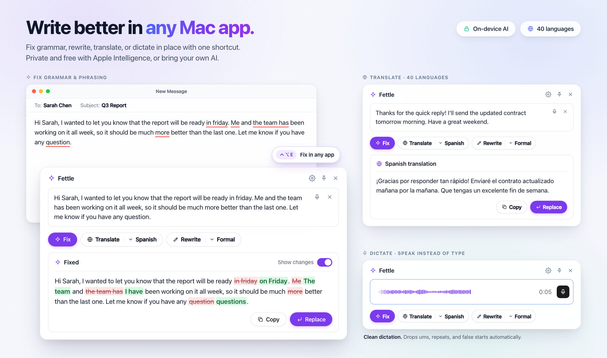

<div align="center">


# Fettle

**Fix grammar, rewrite, and translate in any Mac app with one shortcut.**

Select text, press <kbd>⌃</kbd><kbd>⌥</kbd><kbd>E</kbd>, or let Fettle underline mistakes as you type.<br>
A free, open-source Grammarly alternative for macOS that can run entirely on your Mac.

[](https://github.com/iyazerski/fettle/releases/latest/download/Fettle.dmg)
[](#get-started)
[](LICENSE)
[](https://buymeacoffee.com/iyazerski)

<picture>
  <source media="(prefers-color-scheme: dark)" srcset="docs/screenshots/hero-dark.png">
  
</picture>

</div>

## Why Fettle

- **A lighter, free Grammarly alternative.** Underlines mistakes as you type in Mail, Slack, Notes, Chrome, and most Mac apps. Click an underline to fix it, and click any change you don't want to keep your original wording. No account, no subscription, and no browser extension. It's a 10 MB native app that uses about 12 MB of memory when idle.
- **Write like a native, in any language.** Fix catches grammar, spelling, and awkward or literally translated phrasing while keeping your meaning, tone, links, and formatting intact. Need a different tone? Rewrite to be **Formal**, **Friendly**, **Shorter**, or **Clearer** in one click.
- **Natural translation in 40 languages.** Like Google Translate or DeepL, but right where you write and sounding like a person wrote it, not word by word. Names, tone, and formatting stay as they are.
- **Talk instead of type.** Click the mic and just speak. Fettle drops the ums, repeats, and false starts, adds punctuation, and hands you a clean message. Built-in dictation types what you said. Fettle writes what you meant.
- **Works where you write.** Select text in any app, press <kbd>⌃</kbd><kbd>⌥</kbd><kbd>E</kbd>, and put the result back with <kbd>⌘</kbd><kbd>↩</kbd>. No copying between tabs.
- **Private and free with Apple Intelligence.** On macOS 26, Fettle can use Apple's on-device model so your text never leaves your Mac. Want a bigger model? Use your ChatGPT plan, or OpenAI, OpenRouter, Ollama, or LM Studio. Open source (MIT), with no telemetry and no servers of ours.

## Get started

Works on **macOS 13 or later** on Apple silicon (M1 and newer). The on-device model needs **macOS 26** with Apple Intelligence turned on.

Pick an install option:

- **Download:** get [**Fettle.dmg**](https://github.com/iyazerski/fettle/releases/latest/download/Fettle.dmg), open it, and drag Fettle into Applications.
- **Homebrew:** `brew install --cask iyazerski/tap/fettle`
- **Terminal** (skips the first-launch macOS warning):

```sh
curl -fsSL https://raw.githubusercontent.com/iyazerski/fettle/main/install.sh | sh
```

Because Fettle isn't notarized by Apple yet, opening the `.dmg` or Homebrew install shows a first-time warning: click **Done**, open **System Settings → Privacy & Security**, scroll to **Security**, and click **Open Anyway**. The Terminal command above skips that warning.

Open Fettle to pick your AI model and allow Accessibility when asked. Then select text in any app and press <kbd>⌃</kbd><kbd>⌥</kbd><kbd>E</kbd>.

## FAQ

<details>
<summary><b>Why the name?</b></summary>

To fettle is an old English word for to tidy up or put right, and "in fine fettle" means in good shape. That's what Fettle does to your text.

</details>
<details>
<summary><b>Is Fettle a Grammarly alternative?</b></summary>

Yes, for the core job: fixing grammar, spelling, and phrasing in any app, with a clear view of what changed. Select text and press the shortcut whenever you want a check. Or turn on **Underline mistakes** in Settings: when you pause typing, Fettle sends each paragraph you edited to the model and underlines what it would fix, and a click on an underline shows the fix. Each edited paragraph is a request, so this costs more with a paid model. Only multi-line text boxes, such as message composers and documents, are checked, not address bars or search boxes. Underlines show in apps that tell macOS where their text is on screen, which most native Mac apps and Chrome do. Telegram and WhatsApp aren't checked.

</details>
<details>
<summary><b>Which apps does it work in?</b></summary>

Any app where you can select text and copy it with <kbd>⌘</kbd><kbd>C</kbd>. **Replace** needs a text field you can type into.

</details>
<details>
<summary><b>Which languages does it support?</b></summary>

Fix and Rewrite work in any language the model knows, whatever language the app is in. Your text stays in the language you wrote it in. Translate goes into 40 languages. The app itself is in English, Spanish, French, German, Portuguese, Polish, Russian, Chinese, Japanese, Korean, Hindi, and Arabic, and follows your Mac's language unless you pick one in Settings.

</details>
<details>
<summary><b>Which AI models can I use?</b></summary>

- **On this Mac:** Apple's on-device model, which comes with Apple Intelligence on macOS 26. It's free and private, though smaller, so it handles shorter texts and fewer languages.
- **ChatGPT plan:** the models your plan offers through Codex.
- **API:** any OpenAI-compatible API (OpenAI, OpenRouter, Ollama, LM Studio, and others) that lists models at `/v1/models`.

</details>
<details>
<summary><b>Why does Fettle say Apple Intelligence isn't ready?</b></summary>

Turn it on in **System Settings → Apple Intelligence & Siri**. Your Mac and Siri must use the same language, and Apple Intelligence must support it: English, French, German, Italian, Spanish, Portuguese, Japanese, Korean, Chinese, Danish, Dutch, Norwegian, Swedish, Turkish, or Vietnamese. Right after you turn it on, macOS may need a while to download the model.

</details>
<details>
<summary><b>Does it cost anything?</b></summary>

Fettle and the on-device model are free. Other models are billed by your provider: they're part of your ChatGPT plan, or charged by your API provider.

</details>
<details>
<summary><b>Does it run on Intel Macs, Windows, or Linux?</b></summary>

Not yet. Fettle is built for macOS on Apple silicon.

</details>
<details>
<summary><b>Is it safe to grant Accessibility?</b></summary>

Fettle uses it to copy and paste with <kbd>⌘</kbd><kbd>C</kbd> and <kbd>⌘</kbd><kbd>V</kbd> when you call it, and, if you turn on **Underline mistakes**, to read the text box you're typing in. The code is open, so you can check.

</details>

## Privacy

- Fettle has no account, no analytics, and no server of its own.
- With **On this Mac**, your text never leaves your Mac.
- Otherwise, the text you fix, rewrite, or translate goes only to the model provider you chose: OpenAI when you sign in with ChatGPT, or the API URL you entered.
- Dictation uses Apple's speech recognition, on your Mac when it supports your language, else on Apple's servers.
- Your ChatGPT sign-in and API key are kept in the macOS Keychain.
- Fettle restores your clipboard after it copies and pastes.

## Build from source

Fettle is a native Rust app built on the [Rune](https://github.com/anomalyco/rune) UI framework.

```sh
make install   # build Fettle.app and put it in /Applications
make dev       # build Fettle Dev.app, a debug copy that runs beside it
make test
```

Pre-commit hooks run with [prek](https://github.com/j178/prek): `prek install`.

## License

[MIT](LICENSE) © Ihar Yazerski. Fettle includes open-source software under its own licenses: see [THIRD_PARTY_LICENSES.md](THIRD_PARTY_LICENSES.md). Issues and pull requests are welcome: see [CONTRIBUTING.md](CONTRIBUTING.md).

Fettle isn't affiliated with or endorsed by OpenAI or Grammarly. ChatGPT and Grammarly are trademarks of their owners. Signing in with ChatGPT uses the same sign-in as OpenAI's Codex, so it may stop working if OpenAI changes it. An API key works either way.
