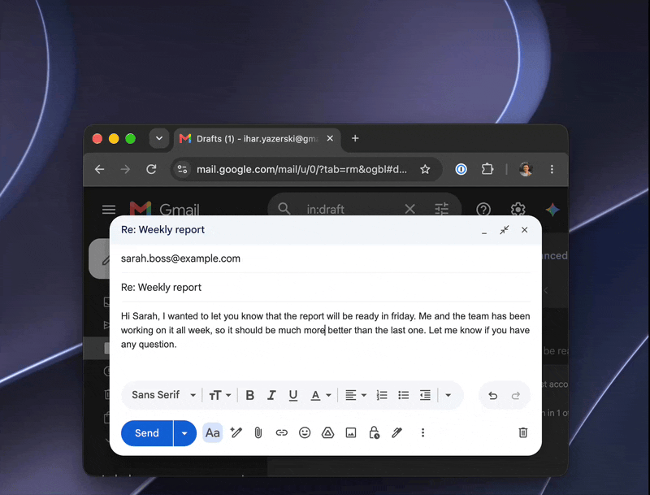
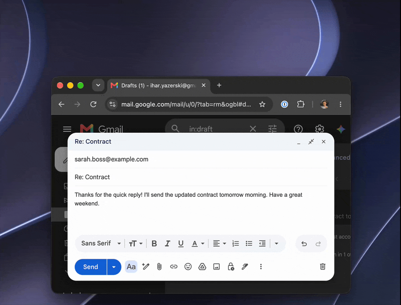

<div align="center">


# Fettle

**Fix grammar and translate text in any Mac app with one shortcut.**

Select text, press <kbd>⌃</kbd><kbd>⌥</kbd><kbd>E</kbd>, and click **Fix** or **Translate**.<br>
A free, open-source AI writing assistant for macOS, and a lightweight alternative to Grammarly.

[](https://github.com/iyazerski/fettle/releases/latest/download/Fettle.dmg)
[](#install)
[](LICENSE)
[](https://www.rust-lang.org)



</div>

## Why Fettle

- **Works in every app.** Mail, Slack, Notes, your browser, your code editor. If you can select the text, Fettle can fix it.
- **See every change.** Fixes show up word by word, like track changes.
- **Translate into 33 languages.** Star the ones you use most to keep them at the top.
- **Paste it back in one keystroke.** <kbd>⌘</kbd><kbd>↩</kbd> replaces your selection with the result. Your clipboard stays as it was.
- **Use your ChatGPT plan or your own API.** Sign in with ChatGPT, or point Fettle at any OpenAI-compatible API, such as OpenAI, OpenRouter, or a local model in Ollama or LM Studio.
- **Native and tiny.** Written in Rust, a 10 MB download, about 12 MB of memory when idle, and no CPU use until you call it.
- **Private by design.** No account, no telemetry, no servers of ours. Your text goes only to the model you pick.
- **Free and open source** under the MIT license.

## Translate

<div align="center">

</div>

Pick a language from the list next to **Translate**. Fettle asks the model to keep the tone, formatting, names, links and code, and to leave text alone if it's already in that language.

> Languages: Amharic, Arabic, Belarusian, Bengali, Chinese (Simplified), English, French, German, Gujarati, Hausa, Hindi, Indonesian, Italian, Japanese, Javanese, Kannada, Korean, Marathi, Persian, Polish, Portuguese, Punjabi, Russian, Spanish, Swahili, Tagalog, Tamil, Telugu, Thai, Turkish, Ukrainian, Urdu, Vietnamese.

## How it works

1. **Select** text in any app.
2. **Press** <kbd>⌃</kbd><kbd>⌥</kbd><kbd>E</kbd>. Fettle copies the selection and opens a small floating window at the top of the screen.
3. **Fix** (<kbd>⌘</kbd><kbd>1</kbd>) corrects grammar, spelling, punctuation and awkward phrasing, without rewriting what's already fine. **Translate** (<kbd>⌘</kbd><kbd>2</kbd>) writes it in the language you picked.
4. **Replace** (<kbd>⌘</kbd><kbd>↩</kbd>) pastes the result over your selection, or **Copy** (<kbd>⇧</kbd><kbd>⌘</kbd><kbd>C</kbd>) puts it on the clipboard.

You can also type or paste text straight into the window.

## Install

For macOS 13 or later on Apple silicon (M1 and newer). Pick one:

- [**Download**](https://github.com/iyazerski/fettle/releases/latest/download/Fettle.dmg) and install the latest release.
- **Homebrew:** `brew install --cask iyazerski/tap/fettle`

### First launch

Fettle isn't notarized by Apple yet, so macOS blocks it the first time you open it. To allow it:

1. Open Fettle from Applications. macOS says it can't verify the app. Click **Done**.
2. Open **System Settings > Privacy & Security** and scroll down to **Security**.
3. Click **Open Anyway** next to the message about Fettle, and confirm.

## Set up

Fettle opens its settings on the first start:

1. **Model.** Choose one:
   - **ChatGPT plan:** sign in with your ChatGPT account.
   - **OpenAI-compatible API:** enter the base URL and a key.

   Then pick a model from the list and how much it should reason. Reasoning off is the fastest.
2. **Accessibility.** Click **Allow…** and turn Fettle on. Fettle presses <kbd>⌘</kbd><kbd>C</kbd> and <kbd>⌘</kbd><kbd>V</kbd> for you to read the selection and paste the result, and macOS asks for this permission first.
3. **Appearance.** System, Light or Dark.
4. **Shortcut.** Click the field and press a new key combination to change it.
5. **Start at login.** Keeps Fettle ready in the background.

## Privacy

- Fettle has no account and no analytics, and it has no server of its own.
- The text you fix or translate goes only to the model provider you chose: OpenAI when you sign in with ChatGPT, or the API URL you entered.
- Fettle restores your clipboard after it copies and pastes.

## FAQ

**Why the name?**
To fettle is an old English word for to tidy up or put right, and "in fine fettle" means in good shape. That's what Fettle does to your text.

**Is Fettle a Grammarly alternative?**
Yes, for the core job: fixing grammar, spelling and phrasing in any app, with a clear view of what changed. It doesn't underline mistakes as you type. You select the text and press the shortcut when you want a check.

**Which apps does it work in?**
Any app where you can select text and copy it with <kbd>⌘</kbd><kbd>C</kbd>. **Replace** needs a text field you can type into.

**Which AI models can I use?**
With a ChatGPT plan, the models your plan offers through Codex. With an API, any model that the API's `/v1/models` endpoint lists.

**Does it cost anything?**
Fettle is free. The model is billed by your provider: it's part of your ChatGPT plan, or charged by your API provider.

**Does it run on Intel Macs, Windows or Linux?**
Not yet. Fettle is built for macOS on Apple silicon.

**Is it safe to grant Accessibility?**
Fettle uses it only to press <kbd>⌘</kbd><kbd>C</kbd> and <kbd>⌘</kbd><kbd>V</kbd> when you call it. The code is open, so you can check.

## Uninstall

- **Homebrew:** `brew uninstall --zap --cask fettle` removes the app, its settings and its login item.
- **Otherwise:** turn off **Start at login** in Fettle's settings, click **Quit Fettle**, and drag Fettle from Applications to the Trash. To remove its settings and log too, run:

  ```sh
  rm -rf ~/Library/Application\ Support/Fettle ~/Library/Logs/fettle.log
  ```

To drop Fettle from the Accessibility list, select it in **System Settings > Privacy & Security > Accessibility** and click **−**.

## Build from source

Fettle is a native Rust app built on the [Rune](https://github.com/anomalyco/rune) UI framework.

```sh
make install   # build Fettle.app and put it in /Applications
make test
```

Pre-commit hooks run with [prek](https://github.com/j178/prek): `prek install`.

## License

[MIT](LICENSE) © Ihar Yazerski. Fettle includes open-source software under its own licenses: see [THIRD_PARTY_LICENSES.md](THIRD_PARTY_LICENSES.md). Issues and pull requests are welcome: see [CONTRIBUTING.md](CONTRIBUTING.md).

Fettle isn't affiliated with or endorsed by OpenAI or Grammarly. ChatGPT and Grammarly are trademarks of their owners. Signing in with ChatGPT uses the same sign-in as OpenAI's Codex, so it may stop working if OpenAI changes it. An API key works either way.
